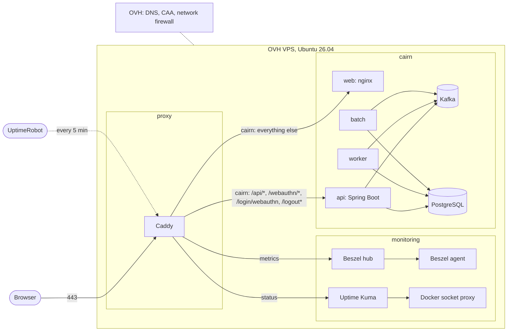

# infra

  
  

The infrastructure behind [cairn.joanroucoux.fr](https://cairn.joanroucoux.fr) and its
[status page](https://status.joanroucoux.fr), as code: Terraform for what exists at OVH, Ansible for
how the machine is configured, a shared Caddy proxy and the monitoring. Today it is one OVH VPS at
`51.255.42.146`, running [Cairn](https://github.com/JoanRoucoux/cairn) and the monitoring. A second
host would be one more inventory entry and its own Terraform resources, not a new repository.

## Tech stack

| Tool | Version | Role |
| ---- | ------- | ---- |
| Terraform | 1.16.2 | OVH resources, state in Terraform Cloud |
| OVH provider | 2.19.0 | DNS records, CAA records, network firewall |
| Ansible | core 2.21.5 | Server configuration, eight roles |
| ansible-lint | 26.9.0 | Playbook and role checks |
| Caddy | 2.11.4 | Shared reverse proxy, automatic Let's Encrypt certificates |
| Uptime Kuma | 2.5.5 | Availability: HTTP, container and push monitors |
| Beszel | 0.20.0 | Host metrics and resource alerts |
| Docker socket proxy | 0.5.0 | Read-only Docker API for the monitoring |
| Ubuntu | 26.04 LTS | Host operating system |

Every tool runs from one pinned toolbox image (`tools/`), so the workstation and the CI use the same
versions. Dependabot keeps the images, the Python tools and the GitHub Actions up to date.

## Quality

`scripts/check.sh` runs locally and in the CI on every push and pull request:

- Terraform: `fmt -check`, then `validate` without a backend
- Ansible: `--syntax-check` on the playbook, then `ansible-lint`
- Proxy: the compose file and the Caddyfile with every site snippet, validated by Caddy itself
  against a throwaway environment

## Layout

    terraform/     OVH resources: VPS (read only), DNS and CAA records, network firewall
    ansible/       Server configuration: base, Docker, users, sshd, ufw, updates, proxy, monitoring
    proxy/         Shared Caddy: ports 80/443, one snippet per site in /srv/proxy/sites/
    monitoring/    Uptime Kuma, Beszel hub and agent, read-only Docker socket proxy
    tools/         The toolbox image: Terraform, Ansible, ansible-lint, pinned collections
    scripts/       toolbox.sh, tf.sh, play.sh, check.sh

## How it fits together

The host runs several applications, so nothing here belongs to any one of them. Three repositories
share it:

    infra        this one: the machine, the DNS, the firewall, the shared proxy, the monitoring
    cairn        the Java backend, the database schema, the batch, its own routing snippet
    cairn-web    the Angular frontend and its nginx image

**Terraform declares what exists at OVH** and never reaches inside the machine: the DNS records for
`cairn`, `status` and `metrics`, a CAA record per subdomain restricting issuance to Let's Encrypt,
and the OVH network firewall that sits in front of the host. That firewall is stateless and IPv4
only, which is why it carries return rules for UDP source ports 53 and 123: without them the server
resolves no name and drifts off the clock. The VPS itself is read through a `data` source, the
provider having rejected its model.

**Ansible declares how the machine is configured.** Its roles run in order: `base` (swap, timezone,
journald cap), `docker` (engine and log rotation), `users` (the `deploy` account the CI logs in as),
`ssh` (key only, no root), `ufw`, `updates`, then `proxy` and `monitoring`, which lay down the two
compose projects this repository owns.

### What runs on the host

Three independent compose projects, each restartable without touching the others:

    proxy/        caddy                                    owns 80, 443 and the certificates
    monitoring/   uptime-kuma, beszel, beszel-agent, socket-proxy
    cairn/        postgres, api, web, schema, batch,       deployed from the cairn repositories
                  kafka, worker

They meet on an external Docker network called `edge`. Caddy is on it, and so are Cairn's `api` and
`web`. **`postgres` is not**: it stays on its project's default network, out of reach of every other
application sharing the proxy.

### The path of a request

    browser
      |
      v 443
    Caddy (proxy project) --- reads /srv/proxy/sites/*.caddy
      |
      +-- cairn.joanroucoux.fr
      |     /api/*            -> api:8080   the /api prefix is stripped on the way
      |     /webauthn/*       -> api:8080   Spring Security serves these three itself
      |     /login/webauthn   -> api:8080
      |     /logout*          -> api:8080
      |     everything else   -> web:80     nginx, static files
      |
      +-- status.joanroucoux.fr  -> uptime-kuma:3001
      +-- metrics.joanroucoux.fr -> beszel:8090

Routing is by path rather than by subdomain so the frontend and the API share **one origin**, which
the session cookie requires (`secure`, `SameSite=Strict`). No backend hostname is therefore baked
into the frontend image. Caddy resolves `api` and `web` per request rather than at startup, so the
proxy comes up and recovers whether or not any application behind it is running.

### The path of a deploy

Neither application repository touches this one. They ship files into `/srv/<app>/` and drop a
routing snippet into `/srv/proxy/sites/`, then reload Caddy rather than restarting it.

    short branch -> PR -> ci + pr-title green -> squash merge on main
                                                    |
                                       GitHub Actions: deploy.yml
                                                    |
      tag --> ci --> images (GHCR, tagged sha-xxxxxxx) --> deploy --> release
                                                             |           |
                                                       ssh deploy@   CalVer tag,
                                                             |       notes by git-cliff
                                                  /srv/cairn/deploy.sh

`cairn-web` runs the mirror workflow for its own service alone. Both scripts take the same
`/srv/cairn/.deploy.lock`, because both edit `/srv/cairn/.env` and GitHub concurrency does not span
repositories. A release records a deployment that worked, so the Releases page of each application
is the history of what production has run.

### Three layers of watching

Uptime Kuma answers "is it up", from inside the host. Beszel answers "is it healthy", on CPU,
memory and disk. UptimeRobot answers both from outside, and is the only layer still standing if the
host goes down with Kuma on it. The next section details what each one monitors.

## Workstation

Docker is the only requirement. The first `scripts/*.sh` call builds the toolbox image, later ones
reuse it. Credentials go in `~/.infra.env`, never in this repository:

    OVH_ENDPOINT=ovh-eu
    OVH_APPLICATION_KEY=...
    OVH_APPLICATION_SECRET=...
    OVH_CONSUMER_KEY=...
    TF_TOKEN_app_terraform_io=...
    ACME_EMAIL=...

SSH keys are read from `~/.ssh`.

## Monitoring

Uptime Kuma at `https://status.joanroucoux.fr` (2FA), Beszel at `https://metrics.joanroucoux.fr`,
UptimeRobot outside the server. All three alert by email through Gmail SMTP with an app password,
configured in each tool's UI and stored in its own volume, never in this repository.

Kuma's monitors live in its SQLite volume. To recreate them:

| Name | Type | Target | Interval |
| --- | --- | --- | --- |
| cairn api | HTTP(s), 200, certificate expiry | `https://cairn.joanroucoux.fr/api/actuator/health` | 60 s |
| cairn web | HTTP(s), 200 | `https://cairn.joanroucoux.fr/` | 60 s |
| container cairn-api-1, cairn-web-1, cairn-postgres-1, cairn-kafka-1, cairn-worker-1, proxy-caddy-1 | Docker Container, host `tcp://socket-proxy:2375` | container name | 60 s |
| batch equity | Push | URL in `/srv/cairn/.env` as `KUMA_PUSH_EQUITY` | 73 h |
| batch etf | Push | `KUMA_PUSH_ETF` | 73 h |
| batch fund | Push | `KUMA_PUSH_FUND` | 73 h |
| batch snapshot | Push | `KUMA_PUSH_SNAPSHOT` | 25 h |
| cairn intraday | Push | `KUMA_PUSH_INTRADAY`, pinged by the worker every 15 minutes | 20 min |
| cairn summary | Push | `KUMA_PUSH_SUMMARY`, pinged by the worker after the daily Telegram summary | 73 h |

A container with a healthcheck restarts through `starting`, which Kuma records as Pending, and Kuma
notifies neither DOWN to Pending nor Pending to UP: container monitors send their DOWN email but
no UP email. The HTTP monitors report the recovery.

A push monitor only takes a fixed interval: equities, ETFs and the summary run on weekdays and funds
from Tuesday to Saturday, so all four tolerate a weekend gap of 72 hours. The snapshot runs every
night and the worker refreshes crypto around the clock, so neither has a weekend gap.

Beszel: system `vps` at `/beszel_socket/beszel.sock`, its public key in
`ansible/group_vars/all.yml`. Alerts: CPU above 80 % for 10 minutes, memory above 90 %, disk
above 80 %, system down. Its SMTP settings live in PocketBase (`/_/`): on port 465, TLS encryption
must be `Always`, not `Auto (StartTLS)`.

UptimeRobot: `https://cairn.joanroucoux.fr/api/actuator/health` and
`https://status.joanroucoux.fr/`, every 5 minutes. The second one is what notices the whole
server going down, Kuma included.

First-run pages are public: create the Kuma and Beszel admin accounts right after the stack
starts, before anyone else reaches them.

## Rebuilding the server from scratch

The database has no off-site backup: the portfolio comes back from a CSV export taken in Cairn, and
passkeys re-register.

1. OVH manager: reinstall the VPS with Ubuntu 26.04 LTS and the `ubuntu` user's SSH key.
2. Record the new host key (`ssh-keyscan -t ed25519 51.255.42.146`) in `DEPLOY_KNOWN_HOSTS` of
   both applications' deploy workflows, and in `~/.ssh/known_hosts`.
3. `bash scripts/play.sh --diff`.
4. Recreate `/srv/cairn/.env` (mode 600, owner `deploy`), redeploy `cairn` then `cairn-web` by
   running their Deploy workflows with the current `main` SHA.
5. Recreate the Kuma and Beszel accounts and monitors from the Monitoring section.

## License

[MIT](LICENSE)
